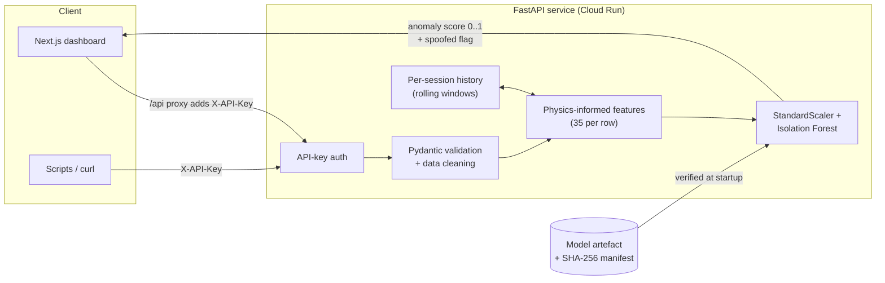

# GNSS Security Shield

**Detect GNSS spoofing from receiver telemetry, without labelled attack data and without extra RF hardware.**

GNSS Security Shield scores every epoch of receiver telemetry with an unsupervised Isolation Forest that was fitted only on genuine signals. Instead of learning what known attacks look like, it learns what authentic satellite signals look like, and flags rows whose physical relationships break: Doppler against range rate, pseudorange against transit time, carrier phase against pseudorange, I/Q power balance and correlator lock. A FastAPI service exposes the detector, and a Next.js dashboard lets an operator upload telemetry logs or inject single signals and watch the anomaly score.

## Architecture



* **Detector** (`src/gnss_shield`): cleaning, feature engineering, model loading with integrity check, scoring.
* **API** (`gnss_shield.api`): `/health`, `/ready`, `/scan`, `/predict`, `/predict/batch`, `/predict/file`, `/reset`.
* **Dashboard** (`frontend/`): Next.js 14 and React 18. Browser calls go to its own `/api` route, which forwards to the detector and adds the API key on the server.
* **Evaluation** (`evals/`): a reproducible protocol that writes `evals/results/RESULTS.md`, and a benchmark that writes `evals/results/EDGE.md`.
* **Deployment** (`deploy/`): scripts for Cloud Run and a billing budget alert, with a teardown script.

More detail, including why the model is unsupervised, is in [docs/ARCHITECTURE.md](docs/ARCHITECTURE.md).

## Features

* **Zero-day oriented.** Trained on genuine telemetry only; no attack signatures.
* **Physics-informed features.** 11 engineered features plus 14 rolling mean/variance features over a 10-epoch window per channel, on top of 10 base fields: 35 model features from 12 required receiver fields.
* **Software only.** Runs on the CPU; the model artefact is about 2.2 MB. It consumes receiver tracking-loop outputs (correlator and I/Q power values), so the receiver must expose them; no antenna or RF front-end change is involved.
* **Validated input.** Every row is checked for the required fields and sensible ranges; malformed rows are rejected with a clear error instead of being scored.
* **Stateful when asked.** Send a `session_id` and rolling windows continue across requests; omit it and each request is scored on its own.
* **Verifiable model.** The model artefact is checked against the SHA-256 and feature list in its manifest at startup.
* **Operable.** Structured JSON logs with request IDs, liveness and readiness endpoints, API-key authentication that fails closed, configurable CORS (closed by default), upload limits.

## Quickstart

### With Docker Compose

```bash
make up
```

This copies `.env.example` to `.env` if needed, builds both images and serves the API on <http://localhost:8000> and the dashboard on <http://localhost:3000>. The example `.env` disables API-key checks for local use only.

### Without Docker

Python 3.10 to 3.13 and Node 20 are required.

```bash
python3 -m venv .venv && source .venv/bin/activate
make install-dev
make dev-api
```

In a second terminal:

```bash
make dev-web
```

### Call the API

```bash
curl -s http://localhost:8000/health
curl -s -F "file=@examples/attack_scenario_sudden.csv" http://localhost:8000/predict/file
```

With authentication on, add `-H "X-API-Key: $GNSS_API_KEY"`. Interactive API docs are served at `/docs`.

## API

| Route | Auth | Purpose |
|---|---|---|
| `GET /health` | no | Liveness |
| `GET /ready` | no | Readiness: 200 once the model is loaded, otherwise 503 |
| `GET /scan` | yes | Model hash, scikit-learn versions, feature count |
| `POST /predict` | yes | Rows as JSON; per-row predictions and engineered features. Optional `session_id` |
| `POST /predict/batch` | yes | Rows as JSON; summary, per-satellite statistics and compact predictions |
| `POST /predict/file` | yes | Upload a `.csv` or `.json` telemetry log; summary and a timeline of up to 200 rows |
| `POST /reset` | yes | Forget one session's rolling-window history |

A row needs `Carrier_Doppler_hz`, `Pseudorange_m`, `RX_time`, `TOW`, `Carrier_phase`, `EC`, `LC`, `PC`, `PIP`, `PQP`, `TCD` and `CN0`; `PRN`, `channel` and `time` are optional. Rows with `PRN = 0` (no satellite lock) are dropped and counted in `rows_dropped`.

## Configuration

All settings are environment variables; see [.env.example](.env.example). The important ones are `GNSS_API_KEY`, `GNSS_AUTH_DISABLED` (local development only), `GNSS_CORS_ORIGINS` and `GNSS_MODEL_PATH`.

## Evaluation and deployment readiness

```bash
make test     # pytest with coverage
make eval     # writes evals/results/RESULTS.md
make bench    # writes evals/results/EDGE.md
make train    # refits the model on data/train.xls and rewrites the manifest
```

`make eval` fits the model on the first 70% of each channel's timeline, injects documented synthetic attacks into the held-out 30%, and reports precision, recall, F1, ROC-AUC, average precision and the confusion matrix per scenario and seed, plus the false-alarm rate on untouched genuine rows. The training data contains no spoofed rows, so these results describe separation of the injected perturbation, not performance against real spoofing hardware.

`make bench` runs in a fresh process and reports model size, peak memory, CPU latency (p50, p95, p99) and throughput by batch size, and lists the receiver fields the detector needs.

Both commands generate their report files; the numbers belong in those files and are not copied here by hand.

## Deploy to Google Cloud

The detector and the dashboard each run as a Cloud Run service that scales to zero. The API key is generated once and kept in Secret Manager.

```bash
export GCP_PROJECT=<project-id>
export GCP_REGION=<region>
make deploy
```

To create a billing budget alert first, set `BILLING_ACCOUNT_ID` and `BUDGET_AMOUNT` and run `make budget`. `make teardown` removes the services, the secret and the service account. Details and limits are in [docs/ARCHITECTURE.md](docs/ARCHITECTURE.md).

## Dataset credit

The telemetry schema (an 8-channel receiver, 13 measurements per record, authentic signals plus simplistic, intermediate and sophisticated spoofing attacks) matches the public dataset below, which is released under CC BY 4.0:

> Aissou, Ghilas. *A DATASET for GPS Spoofing Detection on Unmanned Aerial System*. Mendeley Data, V3, 2022. DOI [10.17632/z7dj3yyzt8.3](https://doi.org/10.17632/z7dj3yyzt8.3). University of North Dakota. Licence: CC BY 4.0.

The sheet in `data/` was used for a college hackathon at SRM and contains only genuine signals. See [data/README.md](data/README.md).

## Project layout

```text
src/gnss_shield/   detector, features, API, training, evaluation library
tests/             pytest suites
evals/             evaluation and benchmark scripts, generated reports
frontend/          Next.js dashboard and its Dockerfile
models/            model artefact and manifest
data/              training sheet and notes on its source
deploy/            Cloud Run, budget and teardown scripts
notebooks/         original Colab notebook
examples/          sample telemetry files
docs/              architecture, roadmap, audit
```

## Roadmap

Planned work, with what each item needs and when it counts as done, is tracked in [docs/ROADMAP.md](docs/ROADMAP.md).
