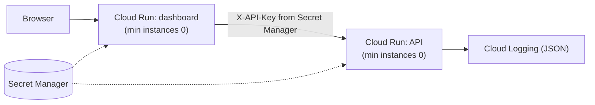

# Architecture

## Why an unsupervised model

A spoofing detector trained on labelled attacks learns the attacks it was shown. A spoofer that behaves differently, or hardware nobody has recorded yet, falls outside that training set. The training sheet in this repository contains no spoofed rows at all, so a supervised model could not be trained on it anyway.

The detector instead models authentic signals. An Isolation Forest isolates rows that sit far from the dense region of genuine telemetry; anything that breaks the learned relationships between fields scores as anomalous, whatever produced it. The cost is that the decision threshold is not calibrated against real attacks: it comes from the `contamination` parameter (0.01) fixed at training time, and the false-alarm rate on genuine data is therefore a design parameter. [ROADMAP.md](ROADMAP.md) lists calibration against labelled data.

## Physics-informed features

A spoofer can imitate individual measurements more easily than the consistency between them. The features encode that consistency. Constants: speed of light *c*, GPS L1 frequency, wavelength λ ≈ 0.1903 m.

| Feature | Definition | What it checks |
|---|---|---|
| `range_rate` | −λ · `Carrier_Doppler_hz` | Range rate implied by Doppler |
| `transit_time_s`, `computed_range` | `TOW − RX_time`; × *c* | Signal travel time against receive time |
| `range_residual` | `Pseudorange_m − computed_range` | Pseudorange against the timing-derived range |
| `phase_range_bias` | `Pseudorange_m − Carrier_phase · λ` | Code and carrier agreement |
| `cn0_pc_ratio`, `cn0_ec_ratio`, `tcd_cn0` | `CN0` or `TCD` over a correlator or `CN0` | Signal strength against correlator and tracking values |
| `iq_imbalance` | (\|PIP\| − \|PQP\|) / (\|PIP\| + \|PQP\| + ε) | In-phase and quadrature power balance |
| `lock_ratio` | `LC` / (\|`EC`\| + ε) | Late against early correlator, a tracking-quality indicator |
| `doppler_delta` | per-channel difference of `Carrier_Doppler_hz` | Epoch-to-epoch Doppler jumps |
| rolling mean and variance | 10-epoch window per channel, for `Carrier_Doppler_hz`, `CN0`, `range_residual`, `iq_imbalance`, `doppler_delta`, `phase_range_bias`, `lock_ratio` | Drift and instability over time |

Together with the 10 base fields this gives 35 features. Their order is part of the model contract: `models/gnss_iforest.manifest.json` lists it and a test compares it with `ALL_MODEL_FEATURES`.

## Data flow

1. **Validation.** `/predict` and `/predict/batch` parse rows with Pydantic (finite numbers, `CN0` between 0 and 100, at most 10,000 rows). `/predict/file` accepts `.csv` or `.json` up to a size and row limit. Missing receiver fields are an error, not a default.
2. **Cleaning** (`gnss_shield.data.clean_gnss`). Drops placeholder rows, rows without satellite lock (`PRN = 0`) and rows with non-finite fields, and reports how many were dropped. Training, evaluation and serving all use this one function.
3. **Features** (`gnss_shield.features.engineer_features`). Sorts by channel and time and computes all 35 features per channel.
4. **Scoring** (`gnss_shield.detector.Detector`). The pipeline's decision value is mapped to a 0..1 anomaly score by a fixed linear map and clipped; a row is flagged when the decision value is below 0, which is the Isolation Forest's own outlier rule.

### Sessions

Rolling windows need earlier epochs. A request with a `session_id` gets the last 10 rows per channel for that session prepended before feature computation (those rows are not scored again), and its own rows are stored afterwards. The store is bounded (256 sessions by default, least recently used evicted, 10 rows per channel, at most 64 channels per request), thread-safe and in process memory. A test compares streaming in two requests with scoring the same rows in one request.

Because the store is in memory, it is per instance. On Cloud Run the deployment script enables session affinity, which is best effort; for exact results across instances, send whole batches (`/predict/batch`, `/predict/file`), which are stateless.

## Model artefact

`models/gnss_iforest.pkl` is a scikit-learn pipeline (`StandardScaler`, then `IsolationForest` with 200 trees). `models/gnss_iforest.manifest.json` records its SHA-256, feature list, training settings and the scikit-learn version it was trained with. At startup the loader refuses a file whose hash differs from the manifest or whose feature count differs from the feature contract, and logs a warning if the installed scikit-learn version differs from the trained one. Dependencies are pinned, scikit-learn to the version recorded in the manifest.

A pickle can execute code when loaded. The hash check protects against accidental or tampered files in the artefact directory; it does not make an untrusted pickle safe. Only load artefacts you built or reviewed.

## No new hardware

The detector is software that reads receiver output; it does not add antennas, RF front-ends or sensors. It runs on the CPU with one inference thread per request, and the model artefact is about 2.2 MB. `make bench` measures model size, peak memory, latency and throughput on the machine it runs on.

What it does need is access to **tracking-loop outputs**: `EC`, `LC`, `PC` (early, late and prompt correlator values), `PIP`, `PQP` (prompt in-phase and quadrature power) and `TCD`, plus the usual observables `Carrier_Doppler_hz`, `Pseudorange_m`, `Carrier_phase`, `CN0`, `TOW` and `RX_time`. NMEA sentences and standard RINEX observation files do not carry the correlator and I/Q values, so a receiver that exposes them (typically a software-defined or research-grade receiver) is required. Adapters for specific receivers are not part of this repository.

## Evaluation protocol

`evals/run.py` fits on the first 70% of each channel's timeline and scores the remaining 30% after injecting synthetic attacks (a documented additive perturbation of Doppler, pseudorange and CN0), scattered or in sustained blocks, over several seeds. Labels are used only for scoring. The generated report states the recipe, the split, the labelling convention and its limits, including that rolling windows spread an attack over neighbouring rows, so row-level precision is conservative. See `src/gnss_shield/evaluation.py`.

## Service security

* Authentication is an `X-API-Key` header compared in constant time. If no key is configured and auth was not explicitly disabled, protected routes answer 503 instead of allowing traffic.
* CORS is closed unless origins are listed; credentials are never allowed.
* The dashboard proxies browser calls through its own `/api` route, so the key lives only in server-side environment variables. The dashboard itself has no login: anyone who can open it can use the detector through the proxy. Treat the deployed dashboard as a demonstrator or put it behind Identity-Aware Proxy.
* The container runs as a non-root user; the API image contains the source and the model only.

## Deployment topology

`deploy/deploy.sh` builds both images with Cloud Build (`gcloud run deploy --source`), creates a dedicated runtime service account and the secret, and deploys both services with scale to zero. `deploy/budget.sh` creates a billing budget alert and `deploy/teardown.sh` removes what the deploy created. The memory and concurrency settings in the script were chosen without measurement; [ROADMAP.md](ROADMAP.md) tracks tuning them from `make bench`.
